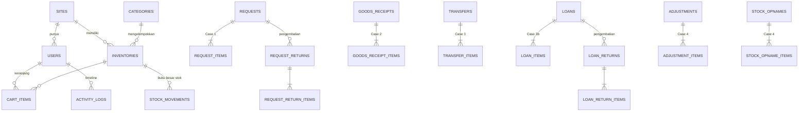
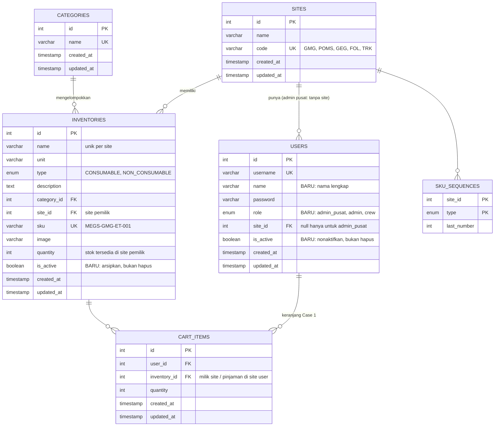
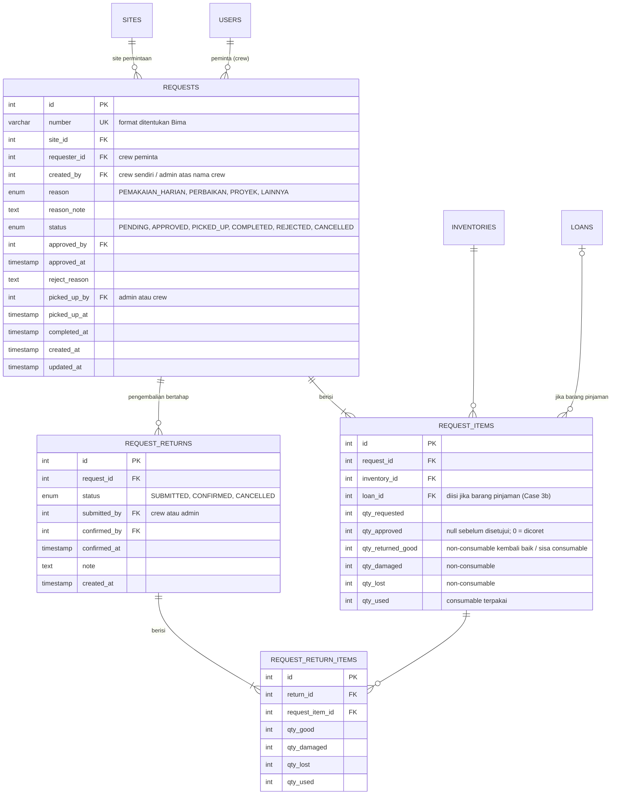
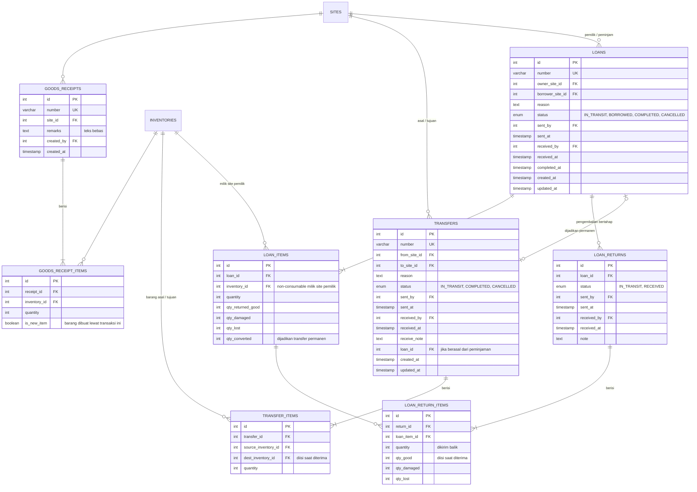
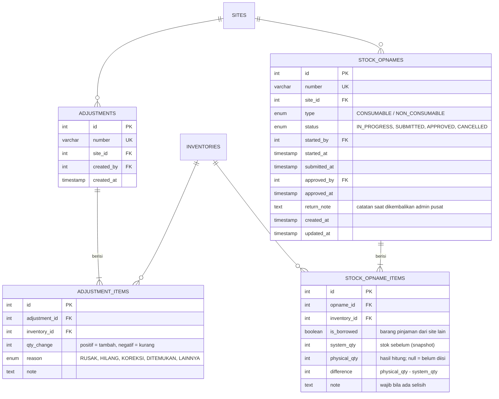
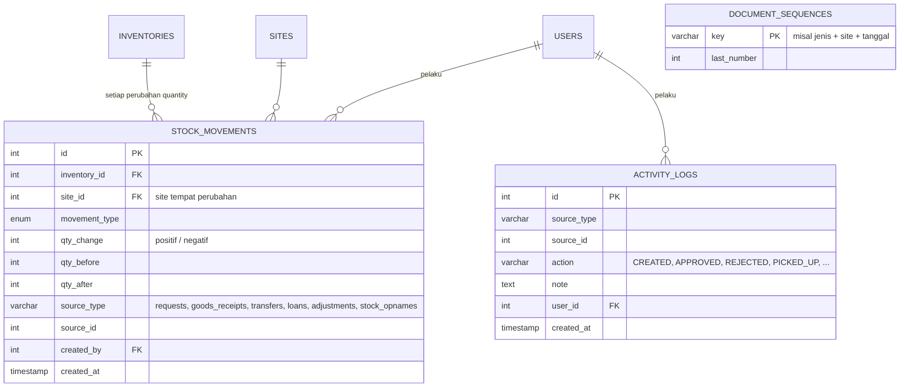

# ERD — Rancangan v2

> Status: **Draf untuk direview** (12 November 2026)
> Dasar: dokumen di `docs/workflow/` (peran, Case 1, 2, 3, 3b, 4).
> Belum ada migrasi; migrasi dibuat setelah rancangan ini disetujui.

## Prinsip rancangan

1. **Satu dokumen per case** — setiap case punya tabel header + item sendiri (permintaan, barang masuk, transfer, peminjaman, adjustment, opname). Status dan kolom tiap case berbeda, jadi tidak dipaksakan ke satu tabel.
2. **Satu buku besar stok (`stock_movements`)** — **setiap** perubahan `inventories.quantity` dicatat di sini: barang apa, berubah berapa, stok sebelum & sesudah, dan dokumen sumbernya. Dipakai untuk riwayat barang, laporan, dan opname.
3. **Satu timeline (`activity_logs`)** — mencatat siapa melakukan apa dan kapan pada setiap dokumen (dibuat, disetujui, diambil, dst.). Menggantikan tabel `histories`.
4. **`inventories.quantity` = stok tersedia di site pemilik.** Jumlah yang sedang dipinjamkan, dibawa crew, atau dalam perjalanan **tidak disimpan terpisah**, tetapi dihitung dari dokumen yang masih aktif.

## Gambaran besar

---

## 1. Master data & pengguna

- `users.role`: `admin_pusat` wajib **tanpa** site; `admin` dan `crew` wajib **dengan** site (dijaga constraint database).
- `cart_items` menggantikan `inventory_carts`; satu barang hanya satu baris per user (`UNIQUE(user_id, inventory_id)`), jumlahnya digabung.

---

## 2. Case 1 — Permintaan & pengembalian

- Item **selesai** bila `qty_returned_good + qty_damaged + qty_lost + qty_used = qty_approved`. Permintaan otomatis `COMPLETED` bila semua item selesai.
- Kolom `qty_*` di `request_items` adalah **total** dari pengembalian yang sudah `CONFIRMED` (memudahkan tampilan & query).
- Tanda merah dihitung dari `approved_at` (> 3 hari belum diambil) dan `picked_up_at` (> 7 hari belum selesai) — tidak perlu kolom tambahan.

---

## 3. Case 2, 3, 3b — Barang masuk, transfer, peminjaman

- Label **"Dalam perjalanan kembali"** pada peminjaman ditampilkan bila ada `loan_returns` berstatus `IN_TRANSIT` (tidak perlu status tersendiri di `loans`).
- Jumlah pinjaman yang **masih di site peminjam** = `quantity − qty_returned_good − qty_damaged − qty_lost − qty_converted − (yang sedang dikirim balik)`.
- Rusak/hilang saat dipakai crew site peminjam (Case 1) menambah `loan_items.qty_damaged / qty_lost`.

---

## 4. Case 4 — Adjustment & stock opname

- **Kunci opname** tidak perlu tabel: transaksi ditahan bila ada `stock_opnames` berstatus `IN_PROGRESS`/`SUBMITTED` untuk site & jenis barang yang sama.
- Hanya satu opname aktif per site per jenis (dijaga partial unique index).

---

## 5. Buku besar stok & timeline

**`movement_type`** (arah perubahan `inventories.quantity`):

| Tipe | Arah | Kapan |
|---|---|---|
| `INITIAL` | + | Barang dibuat langsung dengan stok awal |
| `GOODS_IN` | + | Barang masuk (Case 2) |
| `REQUEST_APPROVED` | − | Permintaan disetujui (Case 1) |
| `REQUEST_CANCELLED` | + | Permintaan yang sudah disetujui dibatalkan |
| `REQUEST_RETURNED` | + | Kembali baik / sisa consumable (Case 1) |
| `TRANSFER_OUT` / `TRANSFER_IN` | − / + | Kirim / terima transfer (Case 3) |
| `TRANSFER_CANCELLED` | + | Transfer dibatalkan |
| `LOAN_OUT` / `LOAN_RETURNED` | − / + | Kirim pinjaman / terima kembali baik (Case 3b) |
| `LOAN_CANCELLED` | + | Peminjaman dibatalkan |
| `ADJUSTMENT` | ± | Adjustment harian (Case 4) |
| `OPNAME` | ± | Opname disetujui (Case 4) |

- Barang **rusak/hilang** setelah keluar gudang tidak mengubah `quantity` lagi (sudah berkurang saat keluar); tercatat di item pengembalian (`qty_damaged`, `qty_lost`) dan bisa dilaporkan dari sana.
- `source_type + source_id` menunjuk ke dokumen sumber (tanpa foreign key, agar satu kolom bisa menunjuk ke beberapa tabel). Integritasnya dijaga di kode.
- `document_sequences` untuk nomor transaksi; formatnya menunggu keputusan Bima.

---

## Perubahan dari skema saat ini

| Tabel | Perubahan |
|---|---|
| `users` | `role` → `admin_pusat` / `admin` / `crew`; tambah `name`, `is_active` |
| `inventories` | tambah `is_active` |
| `inventory_carts` | **dihapus** → `cart_items` |
| `stock_movements` (lama) | **dihapus** → dokumen per case + `stock_movements` baru (buku besar) |
| `histories` | **dihapus** → `activity_logs` |
| `sites`, `categories`, `sku_sequences` | tetap |
| Tabel baru | `requests`, `request_items`, `request_returns`, `request_return_items`, `goods_receipts`, `goods_receipt_items`, `transfers`, `transfer_items`, `loans`, `loan_items`, `loan_returns`, `loan_return_items`, `adjustments`, `adjustment_items`, `stock_opnames`, `stock_opname_items`, `activity_logs`, `document_sequences` |

Tabel yang dihapus saat ini **belum berisi data transaksi**, jadi aman diganti lewat migrasi baru.
