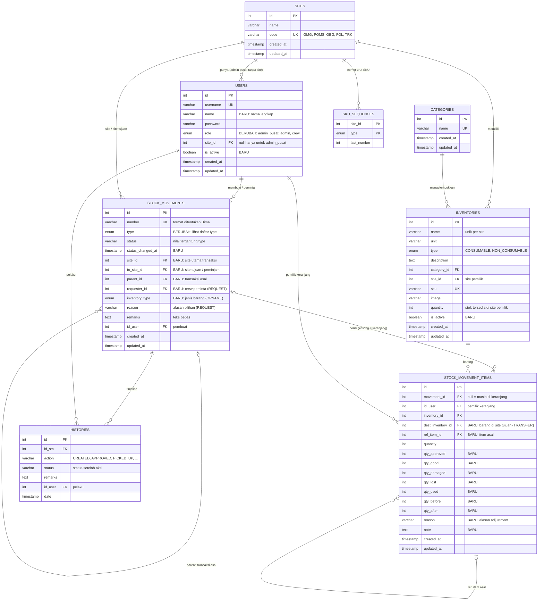

# ERD — Versi Sederhana

> Status: **Disetujui** (12 November 2026)
> Dasar: dokumen di `docs/workflow/` (peran, Case 1, 2, 3, 3b, 4).
> Pendekatan: **ERD lama diperluas** — semua jenis transaksi memakai satu tabel header (`stock_movements`) dan satu tabel item (`stock_movement_items`), dibedakan lewat kolom `type`. Aturan per jenis dijaga di kode (backend).

## Diagram

## Jenis transaksi (`stock_movements.type`)

| `type` | Case | Status yang mungkin | `site_id` | `to_site_id` | `parent_id` |
|---|---|---|---|---|---|
| `REQUEST` | 1 — Permintaan | `PENDING`, `APPROVED`, `PICKED_UP`, `COMPLETED`, `REJECTED`, `CANCELLED` | site permintaan | — | — |
| `RETURN` | 1 — Pengembalian | `SUBMITTED`, `CONFIRMED`, `CANCELLED` | site permintaan | — | `REQUEST` asal |
| `GOODS_IN` | 2 — Barang masuk | `COMPLETED` | site penerima | — | — |
| `TRANSFER` | 3 — Pemindahan | `IN_TRANSIT`, `COMPLETED`, `CANCELLED` | site asal | site tujuan | `LOAN` asal *(jika dari "jadikan permanen")* |
| `LOAN` | 3b — Peminjaman | `IN_TRANSIT`, `BORROWED`, `COMPLETED`, `CANCELLED` | site pemilik | site peminjam | — |
| `LOAN_RETURN` | 3b — Pengembalian pinjaman | `IN_TRANSIT`, `RECEIVED` | site pemilik | site peminjam | `LOAN` asal |
| `ADJUSTMENT` | 4 — Adjustment harian | `COMPLETED` | site | — | — |
| `OPNAME` | 4 — Stock opname | `IN_PROGRESS`, `SUBMITTED`, `APPROVED`, `CANCELLED` | site | — | — |

Kolom khusus header:
- `requester_id` — hanya `REQUEST` (crew yang meminta; `id_user` bisa admin yang membuat atas nama crew).
- `reason` — hanya `REQUEST`: `PEMAKAIAN_HARIAN`, `PERBAIKAN`, `PROYEK`, `LAINNYA`. Catatan alasan di `remarks`.
- `inventory_type` — hanya `OPNAME` (`CONSUMABLE` / `NON_CONSUMABLE`).
- `status_changed_at` — waktu status terakhir berubah; dipakai untuk **tanda merah** (disetujui > 3 hari, diambil > 7 hari, dalam perjalanan > 3 hari).
- Siapa yang menyetujui / mengambil / menerima dan kapan → dicatat di `histories`.

## Pemakaian kolom item (`stock_movement_items`)

| `type` header | `quantity` | Kolom lain yang dipakai |
|---|---|---|
| *(keranjang, `movement_id` kosong)* | jumlah di keranjang | `id_user` |
| `REQUEST` | jumlah diminta | `qty_approved` (0 = dicoret); `ref_item_id` → item `LOAN` jika barang pinjaman |
| `RETURN` | — | `qty_good`, `qty_damaged`, `qty_lost` (non-consumable); `qty_good` = sisa, `qty_used` = terpakai (consumable); `ref_item_id` → item `REQUEST` |
| `GOODS_IN` | jumlah masuk | `qty_before`, `qty_after` |
| `TRANSFER` | jumlah dikirim | `dest_inventory_id` (diisi saat diterima); `ref_item_id` → item `LOAN` jika dari "jadikan permanen" |
| `LOAN` | jumlah dipinjamkan | — |
| `LOAN_RETURN` | jumlah dikirim balik | `qty_good`, `qty_damaged`, `qty_lost` (diisi saat diterima); `ref_item_id` → item `LOAN` |
| `ADJUSTMENT` | perubahan (+/−) | `reason` (`RUSAK`, `HILANG`, `KOREKSI`, `DITEMUKAN`, `LAINNYA`), `note`, `qty_before`, `qty_after` |
| `OPNAME` | hasil hitung fisik (kosong = belum diisi) | `qty_before` = stok sistem (snapshot), `qty_after` = stok setelah disetujui, `note` (wajib bila selisih) |

### Perhitungan (tidak disimpan, dihitung dari data)
- **Item permintaan selesai** bila jumlah `qty_good + qty_damaged + qty_lost + qty_used` dari semua `RETURN` yang `CONFIRMED` = `qty_approved`. Permintaan otomatis `COMPLETED` bila semua item selesai.
- **Sisa pinjaman di site peminjam** = `quantity` item `LOAN` − total dari `LOAN_RETURN` (termasuk yang masih dalam perjalanan) − jumlah yang dijadikan permanen (`TRANSFER` dengan `ref_item_id`) − rusak/hilang saat dipakai crew site peminjam.
- **Label "Dalam perjalanan kembali"** pada `LOAN` tampil bila ada `LOAN_RETURN` berstatus `IN_TRANSIT`.
- **Barang pinjaman di opname** = item opname yang `inventory.site_id` ≠ site opname.
- **Kunci opname** = ada `OPNAME` berstatus `IN_PROGRESS`/`SUBMITTED` untuk site & `inventory_type` yang sama.

## Aturan yang dijaga database

- `users`: `admin_pusat` wajib tanpa site; `admin` & `crew` wajib dengan site.
- `inventories`: `sku` unik; nama unik per site; `quantity >= 0`.
- `stock_movements.number` unik.
- Keranjang: satu barang hanya satu baris per user (`UNIQUE(id_user, inventory_id)` untuk baris dengan `movement_id` kosong).
- Hanya satu `OPNAME` aktif per site per `inventory_type` (partial unique index).
- Selebihnya (status valid per `type`, kolom mana yang wajib) dijaga di **kode backend**.

## Perubahan dari skema saat ini

| Tabel | Perubahan |
|---|---|
| `users` | `role` → `admin_pusat` / `admin` / `crew` (admin dari seed → `admin_pusat`); tambah `name`, `is_active` |
| `inventories` | tambah `is_active` |
| `stock_movements` | `type` diganti daftar baru; tambah `status_changed_at`, `site_id`, `to_site_id`, `parent_id`, `requester_id`, `inventory_type`; `receipt` → `number` |
| `inventory_carts` | **berganti nama** → `stock_movement_items`; `id_sm` → `movement_id`; tambah kolom `qty_*`, `dest_inventory_id`, `ref_item_id`, `reason`, `note`; kolom `status` & `receipt` dihapus |
| `histories` | tambah `action`; status mengikuti `type` transaksi |
| `sites`, `categories`, `sku_sequences` | tetap |

Tabel transaksi saat ini **belum berisi data**, jadi aman diubah lewat migrasi baru.
